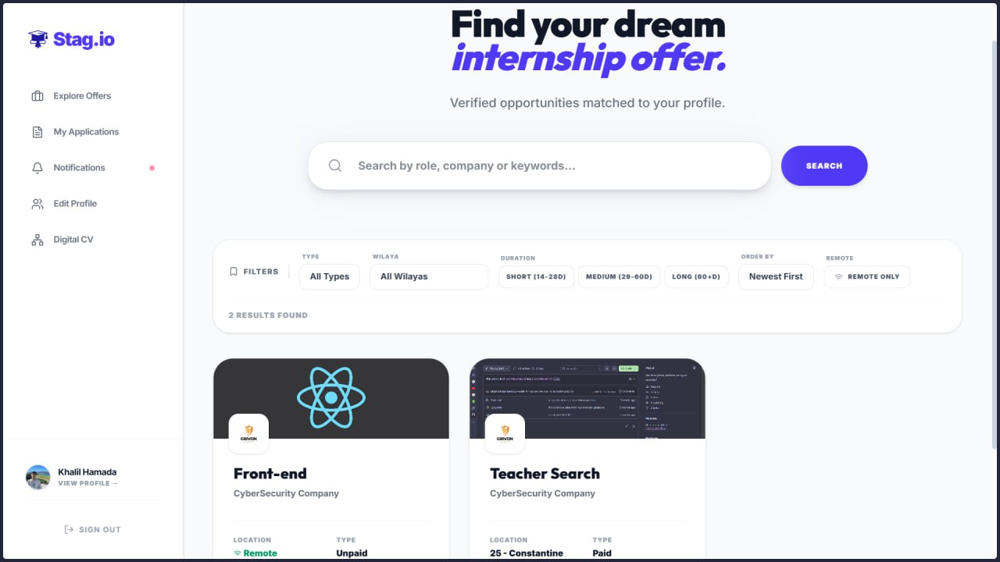
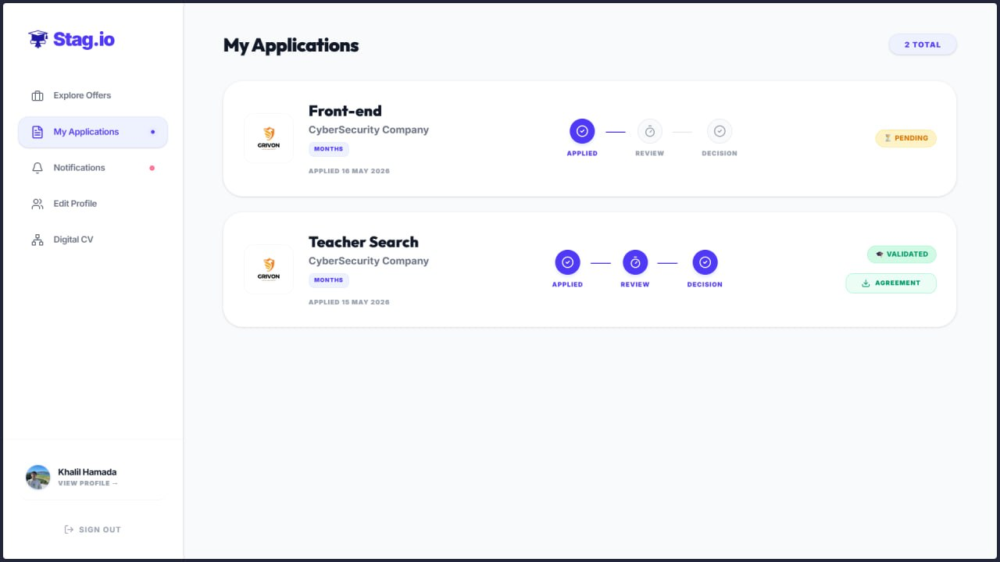
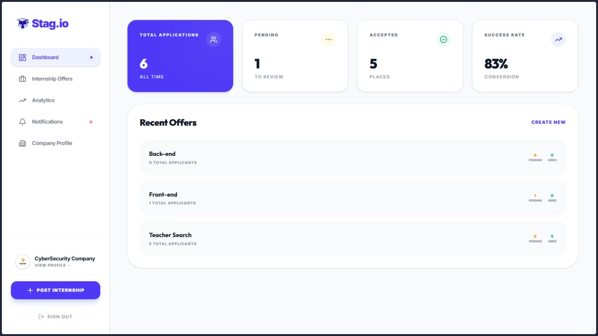
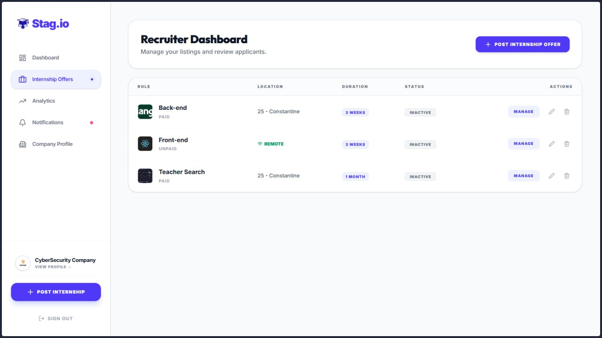
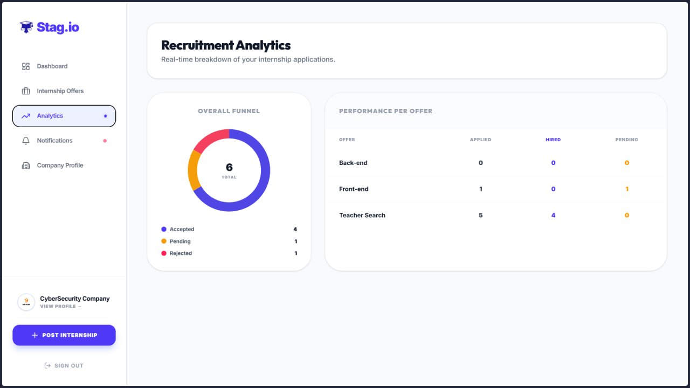
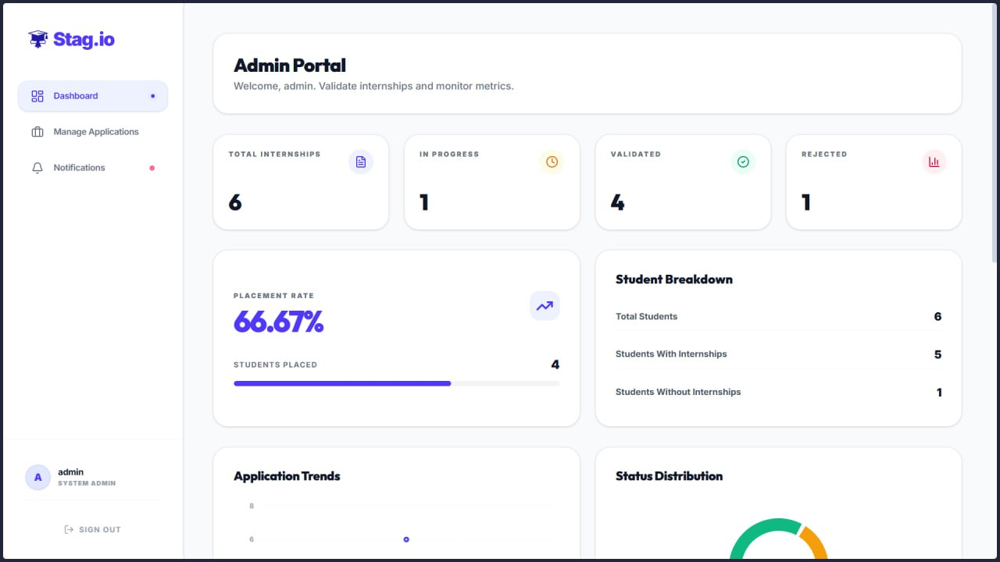
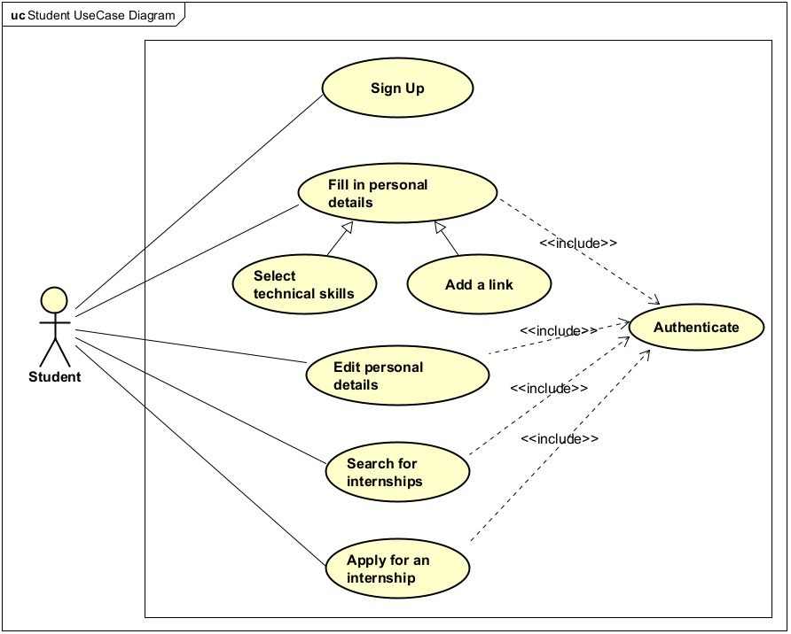
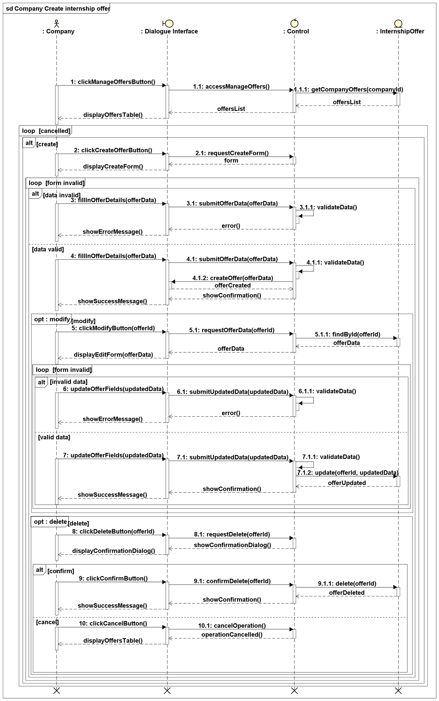
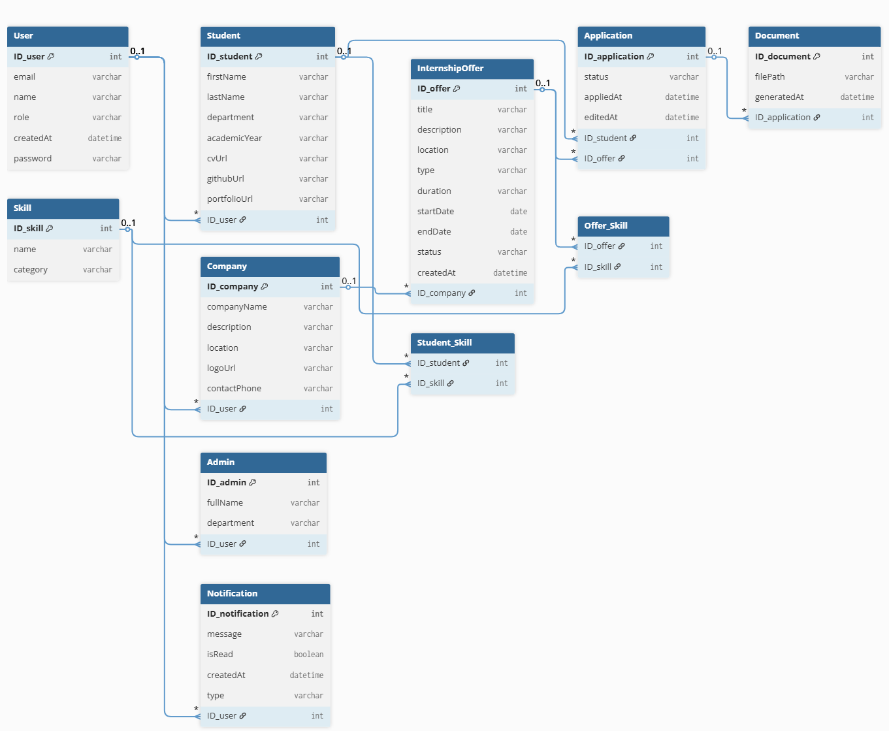

# Stag.io

**Internship management platform connecting students, companies and university administration.**
Built with Django REST Framework, React and PostgreSQL. Bachelor's graduation project (L3 Information Technologies, Constantine 2 University, 2025/2026), developed by a team of three.

> This repository is my fork of the team repository: <https://github.com/abderrahmannemmour-code/PROJECT_LSN>

## The problem

At our university, internships are arranged through scattered channels: generic job boards, email chains and paper forms that need several signatures. Stag.io brings the whole process into one place: finding an offer, applying, company review, administrative validation and the internship agreement.

## Features

| Actor | What they can do |
| --- | --- |
| **Student** | Register, build a profile with skills and links (GitHub, portfolio), search and filter offers, apply, track application status, receive notifications, download the internship agreement once validated |
| **Company** | Register, publish and manage internship offers, review applicants and their digital CV, accept or reject, view recruitment analytics |
| **Administrator** | Validate internships, monitor placement statistics, manage applications, generate official agreements, supervise users |

Under the hood:

- JWT authentication (access 30 min, refresh 7 days) with role-based permission classes (`student` / `company` / `admin`)
- Internship workflow states: pending, accepted, validated, rejected
- Centralized notification service
- Automatic PDF generation of the internship agreement
- Offer search and filtering by type, location, duration and remote option
- Interactive API documentation (Swagger UI, drf-spectacular) at `/api/docs/`

## Screenshots

### Student



### Company




### Administration


## Design (UML)

Analysis and design were done with Astah UML: use case, class, activity, sequence and navigation diagrams, plus textual use-case descriptions.





## Tech stack

| Layer | Technology |
| --- | --- |
| Backend | Django 3.2 + Django REST Framework 3.12 |
| Frontend | React 18, Vite, Tailwind CSS |
| Auth | Simple JWT |
| Database | PostgreSQL 13 |
| API docs | drf-spectacular (Swagger UI) |
| Containers | Docker & Docker Compose |
| Linting | Flake8, ESLint |

## Architecture

Three-tier client-server architecture: a React single-page app talks to a Django REST API over HTTPS/JSON, which persists to PostgreSQL through the Django ORM.

```
Back-end/
├── Dockerfile
├── Docker-compose.yaml
├── requirements.txt
└── stag_io/
    ├── manage.py
    ├── core/        # Custom user model, notifications, helpers
    ├── user/        # Registration, auth, profile API
    └── stag_io/     # Django settings & URL config

Front-end/
├── package.json
├── vite.config.js
├── tailwind.config.js
└── src/
    ├── api/         # API integration
    ├── components/  # Reusable React components
    ├── pages/       # Views organized by role
    └── context/     # React context (e.g. AuthContext)
```

## Data models

- **User**: base model (email login, role: `student` / `company` / `admin`)
- **Student**: full name, wilaya, GitHub link, portfolio link, profile image
- **Company**: name, description, wilaya, website, logo
- **Admin**: department, title

See the full relational model in `docs/uml/relational-model.png`.

## API (user module)

Base path: `/api/user/`. The complete, interactive reference is available at `/api/docs/` once the server is running.

| Method | Endpoint | Description | Auth |
| --- | --- | --- | --- |
| POST | `register/student/` | Register a student | None |
| POST | `register/company/` | Register a company | None |
| POST | `token/` | Obtain JWT access/refresh pair | None |
| POST | `token/refresh/` | Refresh an access token | None |
| GET / PATCH | `me/` | Current user | JWT |
| GET / PATCH | `me/student/` | Student profile | JWT |
| GET / PATCH | `me/company/` | Company profile | JWT |
| PATCH | `me/upload-logo/` | Upload company logo | JWT |
| PATCH | `me/upload-profile-image/` | Upload student profile image | JWT |
| DELETE | `<id>/delete/` | Delete any user (admin only) | JWT |

## Getting started

Prerequisites: Docker & Docker Compose, Node.js.

```bash
# 1. Back-end
git clone https://github.com/Akram-Ad12/Stag.io_GraduationProject.git
cd Stag.io_GraduationProject/Back-end
docker-compose up --build        # API at http://localhost:8000, migrations run automatically

# 2. Front-end
cd ../Front-end
npm install
npm run dev                      # app at http://localhost:5173
```

Useful commands:

```bash
docker-compose run --rm stag_io sh -c "python manage.py createsuperuser"
docker-compose run --rm stag_io sh -c "python manage.py test"
docker-compose run --rm stag_io sh -c "flake8"
```

## Team and my contribution

Team of three. My part:

- **Project and logic management:** defined how the platform should work and the workflows between the three actors
- **Analysis and design:** UML diagrams (use case, class, activity, sequence, navigation) with Astah UML, and the textual use-case descriptions the application is built on
- **Backend and database:** Django 3.2 + Django REST Framework 3.12 + PostgreSQL, run locally with Docker (pair-developed with a teammate)
- **Features:** mainly the student and company actors and everything related to them
- **Documentation:** helped in writing the graduation thesis (can be found in Stag.io_GraduationProject/Stag.io_readme_package)

Teammates: _[Nemour Abderahmene](https://github.com/abderrahmannemmour-code)_ and _[Cheniti el houceine chiheb eddine](https://github.com/chihebcheniti)_

